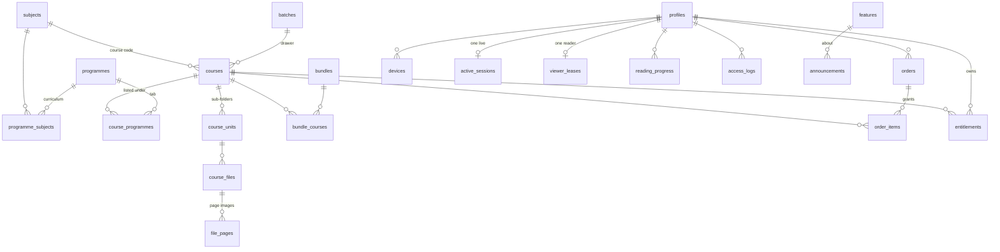

# Database design

Scholars Stack runs on Supabase Postgres. The schema lives in `supabase/migrations/`, one file per area, applied in order. This page is the map: what each table is for, the rules every table follows, and how to extend it without breaking anything.

- **Apply it:** `pnpm ops db:apply` (with `SUPABASE_ACCESS_TOKEN` in `.env`), or paste `supabase/apply-all.sql` into Supabase → SQL Editor → Run. Both are safe to repeat.
- **Check it:** `pnpm db:verify` builds the whole schema in an in-memory Postgres and runs 55 checks: payments, row-level security, triggers, audit, views, and the paste-in file.

---

## The map



| Area | Tables | What it holds |
|---|---|---|
| **0100 Foundation** | `audit_log` | Helpers every table uses: `set_updated_at()`, `is_vit_user()`, `audit_row()`. |
| **0200 Academic** | `batches`, `programmes`, `subjects`, `programme_subjects` | The university's own structure, independent of what we sell. Future tools (CGPA calculator, timetable maker, faculty or club pages) build on these. |
| **0300 Content** | `courses`, `course_programmes`, `course_units`, `course_files`, `file_pages` | What we sell. A course is one R2 folder, its units are the sub-folders, its files are mirrored from R2. |
| **0400 Accounts** | `profiles`, `devices`, `active_sessions`, `viewer_leases` | Students, the college-only gate, two devices, one live session, one open reader. |
| **0500 Commerce** | `bundles`, `bundle_courses`, `orders`, `order_items`, `entitlements` | Purchases and access. |
| **0600 Reading** | `reading_progress`, `access_logs` | Where each student stopped; the daily page log. |
| **0700 Engagement** | `features`, `announcements`, `email_quota` | Free tools and feature emails. |
| **0800 Reporting** | views `course_overview`, `sales_daily` | Health and revenue at a glance (Supabase → Table editor, or `pnpm ops status`). |
| **0900 Reference data** | rows only | The six programmes, 35 subject codes, the curriculum, the starter tools. |

### How R2 maps to rows

```
drive-imports/23 Batch/Database Management Systems (CSE3001)/Module 2/SQL notes.pdf
               │        │                              │         └ course_files (source_key = full key)
               │        │                              └ course_units  key "module-2", kind "module"
               │        └ courses  title "Database Management Systems", subject_code "CSE3001"
               └ batches  2023
```

- The course is listed under every programme whose curriculum includes CSE3001 (`programme_subjects` → `course_programmes`). The admin can change this.
- Converted pages go to `pages/<file id>/<n>.webp`, and the public page-one preview to `pages/<file id>/preview.webp`.

### Kept off the site

- **Hidden units.** `course_units.kind = 'reference'` (folders like "Reference Books", "Ref Books") start hidden.
- **Hidden files.** Files whose names look like publishers' textbooks start hidden: z-lib, "edition", Grewal, Kreyszig, "Reference book"…
- **The effect.** Hidden material is never listed, previewed, sold or converted.
- **Your choice wins.** Change it in Admin → Courses → **Files**. Later imports never override the admin's choice.

---

## Rules every table follows

1. **Keys.** Tables use `id uuid` unless a natural key exists: batch `year`, programme `slug`, subject `code`, feature `key`. Natural keys use `on update cascade`, so renaming a slug carries through.
2. **Timestamps.** Mutable tables have `created_at` and `updated_at`. `updated_at` is set by trigger, never by app code.
3. **Statuses are text + CHECK.** Adding a value is one `alter table … drop constraint / add constraint`. There's no enum type to migrate.
4. **Integrity lives in the database, not only in code.**
   - A file can't sit in another course's unit (composite foreign key).
   - An order must name a course or a bundle, and grant at least one course.
   - Prices have sane ranges, and slugs and codes have fixed formats.
5. **Atomic money paths.** `create_order` writes an order and its `order_items` together. `grant_order` is idempotent, because the checkout callback and the webhook can both arrive. `revoke_by_payment` undoes exactly what one payment granted.
6. **History.** Admin-managed tables write every change (old → new values) to `audit_log`: prices, publishing, programmes, subjects, bundles, tools, and hiding units or files. High-churn tables are left out on purpose.
7. **Security.**
   - RLS is on for every table.
   - The API uses the server (secret) key and filters by user itself. Policies only allow what a signed-in college browser may read.
   - Tile seeds, announcements, quotas and the audit log have **no** browser policy.
   - Functions are `SECURITY DEFINER` with a pinned `search_path`, and `EXECUTE` is revoked from `anon` and `authenticated`.
   - Views use `security_invoker`, so they never leak more than their tables.
8. **Snapshots.** `order_items` freezes what a bundle granted, so editing a bundle later never changes an earlier buyer's purchase.

---

## Extending it

**Always add a new migration; never edit an applied one.**
1. Create `supabase/migrations/<yyyymmddhhmmss>_<what>.sql`, one area per file.
2. Run `pnpm db:verify` and add a check for the new rule.
3. Run `pnpm db:bundle` (refreshes the paste-in file).
4. Run `pnpm ops db:apply`.

Common next steps, and where they go:

| You want… | Do this |
|---|---|
| A new programme | Insert a row in `programmes` and its subjects in `programme_subjects` (Table editor, or a migration like 0900). |
| Credits for the CGPA calculator | Fill `subjects.credits`. The tool reads subjects by code. |
| A timetable maker | New table `subject_slots (subject_code → subjects, slot text, day, start, end)`. |
| Faculty or club pages (the `faculty/` and `clubs/` folders already in R2) | A new area migration: `faculty (id, name, department, …)`, `faculty_subjects (faculty_id, subject_code)`, `clubs (id, slug, name, logo_key)`. They hang off `subjects` and `profiles` the same way content does. |
| Coupons | `coupons (code pk, percent_off, valid_until, max_uses)` plus `orders.coupon_code` → coupons. |
| Student roles (class reps, editors) | `profiles.role text check (role in ('student','editor','admin'))`. Today admins come from `ADMIN_EMAILS`. |

---

## Housekeeping

- `select public.prune_access_logs();` deletes page logs older than 30 days. Run it monthly: SQL Editor, `pg_cron`, or a GitHub Action.
- **Backups.** The **Database backup** workflow dumps schema and data nightly (30 days kept).
- **Sizes at 5,000 students** stay far inside the free tier:
  - **Biggest tables:** `access_logs`, about 100k rows a month before pruning, and `file_pages`, about 15k rows for your current notes.
  - **Indexes:** every foreign key has one, plus partial indexes for the hot paths ("pending files", "active devices", "mailable profiles").
