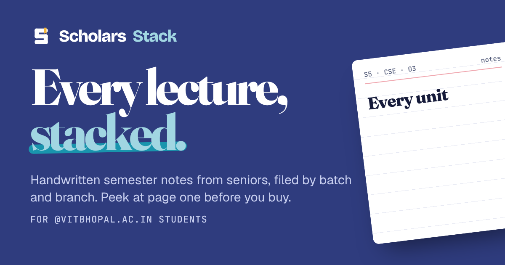
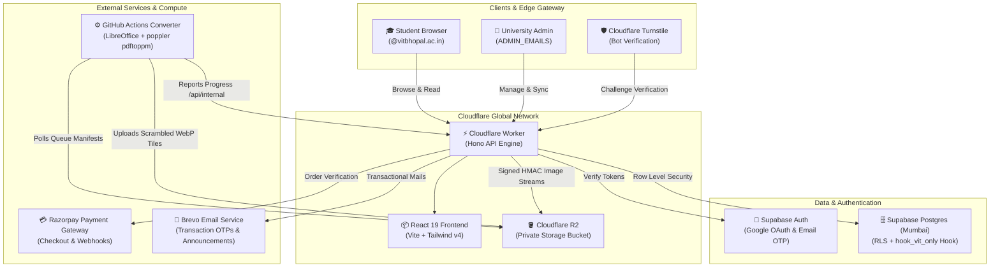
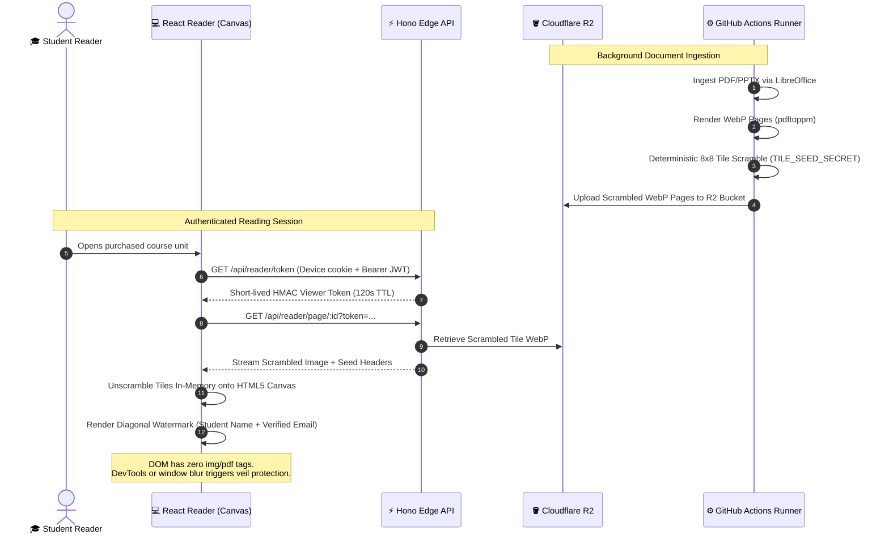

<p align="center">
  
</p>

# 📚 Scholars Stack

<p align="center">
  <strong>A vintage-inspired digital library catalogue and secure academic notes platform built specifically for VIT Bhopal University students.</strong>
</p>

<p align="center">
  <a href="https://scholarstack.campusnotes.workers.dev"></a>
  <a href="https://github.com/Vraj26shah/scholarstack"></a>
  
  
  
  
  
  
</p>

---

## 📌 Quick Links

- **🌐 Live Production Website:** [scholarstack.campusnotes.workers.dev](https://scholarstack.campusnotes.workers.dev)
- **👨‍💻 Author & Lead Maintainer:** [Vraj Shah (@Vraj26shah)](https://github.com/Vraj26shah)
- **📫 Developer Inquiries:** [vraj1012006shah@gmail.com](mailto:vraj1012006shah@gmail.com)
- **🏢 Support & Note Submissions:** [vitbsmashers@gmail.com](mailto:vitbsmashers@gmail.com)

---

## 📖 Table of Contents

- [Vision & The Problem](#-vision--the-problem)
- [Core Features](#-core-features)
  - [Physical Library Metaphor UI](#1-physical-library-metaphor-ui)
  - [Anti-Piracy DRM & Protected Canvas Reader](#2-anti-piracy-drm--protected-canvas-reader)
  - [Institutional Access & Single Sign-On](#3-institutional-access--single-sign-on)
  - [Device Session & Anti-Sharing Controls](#4-device-session--anti-sharing-controls)
  - [Commerce Engine & Semester Bundles](#5-commerce-engine--semester-bundles)
  - [Distributed Document Conversion Engine](#6-distributed-document-conversion-engine)
  - [Admin Studio & Command Center](#7-admin-studio--command-center)
  - [Student Academic Toolbox](#8-student-academic-toolbox)
- [System Architecture](#-system-architecture)
  - [Interactive Component Flow](#interactive-component-flow)
  - [DRM Scrambling & Reassembly Sequence](#drm-scrambling--reassembly-sequence)
- [Software Engineering & SOLID Principles](#-software-engineering--solid-principles)
- [Tech Stack](#-tech-stack)
- [Repository Layout](#-repository-layout)
- [Quickstart & Local Setup](#-quickstart--local-setup)
  - [Demo Mode in 60 Seconds (Zero External Dependencies)](#-demo-mode-in-60-seconds-no-accounts-needed)
  - [Full Local Development (Real Services)](#-full-local-development)
  - [Everyday Commands](#-everyday-commands)
- [Product Policies](#-product-policies)
- [Author & Contact](#-author--contact)

---

## 💡 Vision & The Problem

University students frequently face a fragmented academic landscape. Quality handwritten notes, exam preparation materials, and previous-year question solutions (PYQs) are scattered across ephemeral WhatsApp groups, unindexed Google Drive links, and Telegram channels. They lack quality control, curriculum alignment, and searchability, while note creators receive no credit or remuneration for their hard work.

**Scholars Stack** reimagines academic study materials as an authentic, tactile physical library catalogue:
- **Organized Systematically:** Filed strictly by **Batch Year → Branch → Course → Units & PYQs**.
- **Verified Senior Notes:** High-quality handwritten summaries prepared by seniors who aced the exact same curriculum.
- **Fair Academic Commerce:** Students can preview page one of every unit before purchasing individual courses or deeply discounted semester bundles via Razorpay.
- **Military-Grade DRM:** Notes remain strictly read-only on an in-browser canvas with tile-scrambled assets, dynamic personal watermarks, and zero raw file downloads.

---

## ✨ Core Features

### 1. Physical Library Metaphor UI
- **Vintage Wooden Drawers:** Select semester cohorts (e.g., `23 Batch`, `24 Batch`) designed like pull-out library card drawers.
- **Brass Branch Divider Tabs:** Seamlessly switch between programmes: Computer Science & Engineering (Core), AI & Machine Learning, Cloud Computing & Virtualization, Cyber Security & Digital Forensics, and more.
- **Index Cards & Call Numbers:** Authentic library catalogue cards displaying course codes, professor/senior credits, unit syllabus coverage, and page counts.
- **Virtual Bookshelf ("My Shelf"):** Active courses stand as embossed hardcover book spines with ribbon bookmarks, reading completion meters, and resume-reading triggers.
- **Tactile Paper Polish:** Fluid micro-interactions including card deal shuffles, rubber stamp thud animations on checkout, and hand-drawn marker underlines.

### 2. Anti-Piracy DRM & Protected Canvas Reader
- **8×8 Server-Side Tile Scrambling:** Uploaded documents are parsed into high-resolution WebP pages, divided into an 8×8 grid, and deterministically shuffled on the server using an encrypted seed derived from `TILE_SEED_SECRET`. Raw pages stored in Cloudflare R2 are unreadable when viewed directly.
- **Client Canvas Reassembly:** The custom reader downloads scrambled tiles and reassembles them in-memory onto an HTML5 `<canvas>`. At no point is an `` tag or raw image link exposed to the DOM or browser network tab.
- **Dynamic Personalized Watermarking:** An indelible diagonal watermark bearing the verified student's full name, registration number, and `@vitbhopal.ac.in` email address is baked directly into the canvas pixels.
- **Anti-Inspection & Screen Protection:** Right-click, image dragging, text selection, and keyboard print shortcuts (`Ctrl+P`, `Cmd+P`) are blocked. If browser DevTools or window loss-of-focus is detected, an opaque protective veil obscures note content.
- **Cryptographic Viewer Tokens:** Page viewing requires a short-lived HMAC token (`VIEWER_TOKEN_SECRET`) with a 120-second lease renewed exclusively via an active reading heartbeat. Reading is rate-limited to 40 pages/minute and 600 pages/day.

### 3. Institutional Access & Single Sign-On
- **Strict `@vitbhopal.ac.in` Domain Barrier:** Only verified college accounts can authenticate. Enforced redundantly at three independent levels:
  1. *Database Hook:* PostgreSQL `public.hook_vit_only` aborts non-institutional user creation.
  2. *Supabase RLS Policies:* Direct access denied to unverified emails.
  3. *Cloudflare Worker Middleware:* Drops requests with mismatched domains.
- **Passwordless Security:** Sign-ins operate exclusively through Google OAuth 2.0 or 6-digit email OTPs sent via Brevo. No passwords are stored, eliminating credential stuffing and leakage vectors.
- **Bot Defense:** Cloudflare Turnstile CAPTCHA guards all authentication flows.

### 4. Device Session & Anti-Sharing Controls
- **1 Active Session:** A student can read from only one active browser session at any time. Opening a course on a second device displays a "Card in use elsewhere" takeover notice.
- **2 Registered Devices:** Accounts are strictly limited to two registered physical devices, bound via `HttpOnly`, `Secure`, `SameSite=Strict` cryptographically signed cookies (`DEVICE_COOKIE_SECRET`).
- **Cooldown Safeguard:** Removing a registered device enforces a 7-day swap cooldown to prevent account credential sharing among peers.

### 5. Commerce Engine & Semester Bundles
- **Razorpay Integration:** Full checkout modal with UPI, netbanking, cards, and wallet options.
- **Intelligent Bundle Pricing:** Semester-wide bundles (e.g., *Complete 2023 Batch CSE Bundle*) automatically calculate prorated discounts if a student already owns individual constituent courses.
- **Automated Webhook Reconciliation:** Edge-computed HMAC webhook validation captures authorized payments, provisions course entitlements idempotently, and auto-revokes access in the event of payment disputes.
- **All Sales Are Final:** Clearly stated throughout the UI with mandatory page-one previews ensuring informed student purchases.

### 6. Distributed Document Conversion Engine
- **Cloudflare R2 Queue Pipeline:** Conversion jobs are queued as JSON manifests in private R2 storage (`_system/conversion-queues/`).
- **Compute Offloading via GitHub Actions:** A standalone background runner workflow polls conversion manifests, executes headless **LibreOffice** and **Poppler (`pdftoppm`)**, processes multi-format files (PDF, PPTX, DOCX, ODT, PNG, JPG), scrambles tiles, and saves optimized WebP assets back to R2.
- **Bounded Memory Ingestion:** Converts in batches of 8 pages at a time, ensuring flat RAM consumption even for 500+ page textbook PDFs.

### 7. Admin Studio & Command Center
- **R2 ↔ Supabase Differential Sync:** Visual tree inspector compares R2 raw files against Supabase course records. Admins can reconcile differences with a single click while preserving R2 as the immutable source of truth.
- **Course & Unit Importer:** Automatically structures Drive folder exports (`Batch/Course/Unit/file.pdf`) into published courses with custom pricing and draft staging.
- **System Diagnostics & Problems Log:** Aggregated telemetry tracking client errors, ad-blocker payment interferences, and conversion pipeline progress without exposing student PII.
- **Storage Map & Garbage Collection:** Visual breakdown of R2 bucket space and Supabase table sizes with safe orphan-file cleanup.
- **Complimentary Course Access:** Direct grant tool allowing admins to provision free course access to scholarship students or student note contributors.

### 8. Student Academic Toolbox
- **Academic Utilities:** Built-in CGPA / SGPA calculator tailored to university grading scales and semester timetable schedule generator.
- **Broadcast Announcements:** Integrated Brevo email newsletter system with daily pacing and one-click student unsubscribe mechanisms.

---

## 🏗️ System Architecture

Scholars Stack leverages an ultra-low-latency edge topology with Cloudflare Workers, Supabase (Mumbai region), Cloudflare R2 object storage, and GitHub Actions compute.

### Interactive Component Flow



### DRM Scrambling & Reassembly Sequence



---

## 🏛️ Software Engineering & SOLID Principles

The entire API is architected with strict concentric rings inspired by Hexagonal / Clean Architecture. Inner layers know nothing about outer layers.

```text
HTTP Layer (Hono Routes & Middleware)
       │
       ▼
Application Layer (Use Cases & Business Logic)
       │
       ▼
Domain Layer (Pure Entities & Port Interfaces)
       ▲
       │
Infrastructure Layer (Supabase, R2, Razorpay, Crypto Adapters)
```

| SOLID Principle | Concrete Implementation in Scholars Stack |
| :--- | :--- |
| **Single Responsibility (SRP)** | Every application use case handles exactly one action: `StartCheckout`, `ConfirmPayment`, `ClaimDevice`, `OpenReader`, `ServePage`, `SyncCatalogue`. Hono routes simply parse inputs, call a use case, and format the HTTP response. |
| **Open / Closed (OCP)** | Functionality expands by adding new adapters or use cases without altering existing core logic. Introducing an alternative gateway (e.g., Cashfree) requires only a new `CashfreeGateway` implementing the `PaymentGateway` port. |
| **Liskov Substitution (LSP)** | Every infrastructure adapter honors its port interface contract. Each port includes an in-memory test double, ensuring use cases execute identically against mock fakes or production cloud services. |
| **Interface Segregation (ISP)** | Granular, decoupled port interfaces instead of a monolithic database client: `CourseCatalog`, `Entitlements`, `Orders`, `DeviceSessions`, `PageStore`, `PaymentGateway`, `ConversionQueue`, `TokenSigner`, `Clock`. |
| **Dependency Inversion (DIP)** | Use cases depend strictly on abstractions (domain ports). Concrete adapters are instantiated and injected in a single composition root (`composition.ts`). |

---

## 🛠️ Tech Stack

| Domain | Technology | Key Purpose |
| :--- | :--- | :--- |
| **Frontend Framework** | **React 19** + **Vite** | Modern component tree with concurrent rendering and fast client routing |
| **Language** | **TypeScript 5.7+** | End-to-end type safety across web, API, contracts, and converter |
| **Styling & Design** | **Tailwind CSS v4** + **Radix UI** | High-performance CSS engine with accessible, unstyled primitives |
| **State & Cache** | **TanStack Query v5** + **Zustand** | Server state caching, optimistic updates, and lightweight client state |
| **API Framework** | **Hono** | Lightweight, high-throughput edge HTTP framework running on Cloudflare |
| **Validation** | **Zod** | Runtime contract schemas shared across web, API, and converter (`@ss/contracts`) |
| **Database & Auth** | **Supabase (PostgreSQL 15)** | Row Level Security (RLS), custom sign-up trigger hooks, Google OAuth & OTP |
| **Object Storage** | **Cloudflare R2** | Zero-egress-fee private bucket storing raw notes and scrambled WebP tiles |
| **Document Converter** | **LibreOffice** + **Poppler** | Headless document-to-image pipeline running on GitHub Actions runners |
| **Payments** | **Razorpay** | UPI, Netbanking, Cards, Wallets, and edge-verified webhooks |
| **Email Delivery** | **Brevo (Sendinblue)** | SMTP for login codes and REST API for broadcast academic newsletters |
| **Testing & Quality** | **Vitest**, **Playwright**, **Biome** | Unit tests, 28 browser journey tests, and sub-millisecond code linting |

---

## 📂 Repository Layout

```text
scholars-stack/
├── apps/
│   ├── web/                           # React 19 Frontend Web Application
│   │   └── src/
│   │       ├── app/                   # App providers, router, theme management
│   │       ├── features/              # Feature-based modular architecture
│   │       │   ├── auth/              # Sign-in, OTP verification, session guards
│   │       │   ├── catalogue/         # Vintage drawers, branch tabs, index cards
│   │       │   ├── course/            # Course detail cards, unit listings, checkout modal
│   │       │   ├── checkout/          # Razorpay integration & stamp animation
│   │       │   ├── shelf/             # "My Shelf" virtual bookcase with embossed spines
│   │       │   ├── reader/            # Tile unscrambling canvas reader & watermark veil
│   │       │   ├── admin/             # R2 sync, conversion monitor, course manager
│   │       │   ├── legal/             # Terms, Privacy, and Notes Contribution guides
│   │       │   └── tools/             # Student tools (CGPA calculator & timetable)
│   │       ├── shared/                # Design system UI tokens & Storybook stories
│   │       └── lib/                   # API clients, Supabase bindings, query keys
│   └── api/                           # Cloudflare Worker Edge Backend
│       └── src/
│           ├── domain/                # Pure business entities & port interfaces
│           ├── application/           # Focused use cases (application services)
│           ├── infrastructure/        # Cloud adapters: Supabase, R2, Razorpay, Crypto
│           ├── http/                  # Thin Hono routes and security middleware
│           └── composition.ts         # Dependency injection composition root
├── packages/
│   └── contracts/                     # Shared Zod schemas & TypeScript type contracts
├── converter/                         # GitHub Actions headless LibreOffice/poppler runner
├── supabase/
│   ├── migrations/                    # SQL migrations, RLS policies, institutional hook
│   ├── seed.sql                       # Dev seed data (sample cohorts, branches, courses)
│   └── verify-migrations.mjs          # PGlite migration verification without Docker
├── scripts/                           # Dev tooling: env-sync, secrets-push, perf-checks
└── .github/workflows/                 # CI/CD, deployment, and conversion pollers
```

---

## 🚀 Quickstart & Local Setup

### ⚡ Demo Mode in 60 Seconds (No Accounts Needed)

Experience the complete application locally without setting up Supabase, Cloudflare, or Razorpay:

```bash
# 1. Clone the repository
git clone https://github.com/Vraj26shah/scholarstack.git
cd scholarstack

# 2. Install dependencies (requires Node.js 22+ and pnpm)
pnpm install

# 3. Launch Demo Mode
pnpm dev:demo
```

- Open **`http://localhost:5173`** in your browser.
- **Student Sign-in:** Enter any `@vitbhopal.ac.in` email (e.g., `student@vitbhopal.ac.in`) with dummy OTP.
- **Admin Access:** Sign in with username `admin` to explore the full Admin Command Center.
- **Payments:** Test payment workflows with built-in sandbox mock responses.

---

### 💻 Full Local Development

To run with real Supabase, Cloudflare R2, and local document conversion:

```bash
# Copy and configure environment variables
cp .env.example .env

# Sync environment variables across monorepo packages
pnpm env:sync

# Start local Supabase in Docker
pnpm db:start

# Apply migrations and seed data
pnpm db:reset

# Start local web frontend (:5173) and local API server (:8787)
pnpm dev
```

---

### ⌨️ Everyday Commands

| Command | Action |
| :--- | :--- |
| `pnpm dev:demo` | Launch in-memory demo mode with simulated auth and payments |
| `pnpm dev` | Start web (:5173) + API (:8787) with live services and local converter |
| `pnpm test` | Run all unit tests across all packages with Vitest |
| `pnpm test:e2e` | Run Playwright end-to-end browser tests across desktop and mobile |
| `pnpm lint` | Lint codebase with Biome |
| `pnpm typecheck` | Strict TypeScript validation across all workspaces |
| `pnpm db:verify` | Verify all SQL migrations and RLS policies using in-memory PGlite |
| `pnpm deploy:production` | Build and deploy frontend and Worker API to production |
| `pnpm tunnel` | Spin up a Cloudflare Tunnel to test live Razorpay webhooks locally |

---

## 📜 Product Policies

- **Institutional Lock:** Sign-in is restricted strictly to `@vitbhopal.ac.in` addresses.
- **Device Policy:** Maximum of 2 registered devices per student; 1 active reading session at a time.
- **Content Protection:** Zero downloads, zero print permissions, and permanent personalized student watermarks on every page.
- **Refund Policy:** *All sales are final.* Comprehensive unit details, syllabus breakdowns, and page-one previews are provided prior to payment.

---

## 👤 Author & Contact

**Scholars Stack** is designed, developed, and maintained by **Vraj Shah**.

- **🌐 Live Application:** [scholarstack.campusnotes.workers.dev](https://scholarstack.campusnotes.workers.dev)
- **🐙 GitHub Profile:** [@Vraj26shah](https://github.com/Vraj26shah)
- **📦 Repository:** [Vraj26shah/scholarstack](https://github.com/Vraj26shah/scholarstack)
- **✉️ Personal / Maintainer Email:** [vraj1012006shah@gmail.com](mailto:vraj1012006shah@gmail.com)
- **🏢 Support & Official Correspondence:** [vitbsmashers@gmail.com](mailto:vitbsmashers@gmail.com)

---

### 🤝 Share Your Notes (Notes Contribution Program)

Are you a VIT Bhopal student with neat, comprehensive handwritten notes? Instead of purchasing courses, you can **contribute your handwritten notes** and receive free course access in return!

1. Sign in with your college account and open **Contribute** (`/contribute`).
2. Add a title, the course, and up to 5 files (PDF, PowerPoint, Word, ZIP, JPG or PNG).
3. Confirm the notes are your own and press **Send for review**.
4. A curator reviews every file by hand. You're emailed the decision; accepted notes can earn a free course or cash, shown on the Contribute page.

Prefer email? You can still send notes to **[vitbsmashers@gmail.com](mailto:vitbsmashers@gmail.com)**.

---

<p align="center">
  <sub>Built with care for the academic community at VIT Bhopal University.</sub><br/>
  <sub>© 2026 Scholars Stack. All rights reserved.</sub>
</p>
